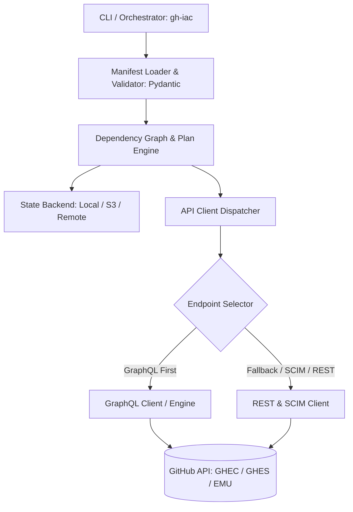

# GitHub IaC Management Engine Architecture & Design Plan

## 1. Executive Summary & Goals
An open, declarative Infrastructure-as-Code (IaC) management system engineered specifically for GitHub environments:
- **Environments in Scope:** GitHub Enterprise Cloud (GHEC), GitHub Enterprise Server (GHES), and GHEC Enterprise Managed Users (EMU).
- **Construct Scope:** Comprehensive coverage across all GitHub constructs.
- **Priority Phasing:**
  1. Enterprise-level constructs (Enterprise policies, licenses, EMU SAML/SCIM settings, external identity mapping, enterprise audit log streaming).
  2. Governance & Security constructs (Custom repository roles, GHAS settings, secret scanning, code scanning default setups, compliance).
  3. Organization & Team constructs (Orgs, Teams, IdP sync, org rulesets, secrets, variables, webhooks).
  4. Repository & Branch constructs (Repos, rulesets, branch protections, environments, deploy keys, actions permissions).
- **Core Design Tenet:** **GraphQL-first, REST-fallback**. All operations default to GitHub GraphQL mutations/queries for performance, transactional granularity, and precision; REST endpoints are dynamically dispatched when GitHub has not exposed GraphQL APIs (e.g. SCIM APIs, some EMU APIs, raw file contents, or legacy GHES features).

---

## 2. System Architecture

### 2.1 Core Modules

1. **`core/client` (Hybrid GitHub Client):**
   - Resolves target endpoint: `api.github.com` (GHEC) vs custom host (GHES e.g. `https://github.internal.domain/api/v3` and `/api/graphql`).
   - Authentication adapters: GitHub Apps (Installation Token rotation), Personal Access Tokens (Fine-grained & Classic), and EMU SCIM bearer tokens.
   - Intelligent Query Engine: Executes GraphQL queries/mutations with retry/rate-limit awareness (e.g. secondary rate limits, cost calculation); falls back cleanly to REST when GraphQL schema lacks mutations/queries.

2. **`core/manifests` (Declarative Schemas):**
   - Kubernetes-style declarative manifests with `apiVersion: github.iac/v1alpha1`, `kind: <Construct>`, `metadata`, and `spec`.
   - Built with Pydantic v2 for strict typing, schema generation, and linting.

3. **`core/engine` (Plan, Diff, & Apply):**
   - **`reconciler`:** Read remote state (via GraphQL query or REST), compute structural diff with desired state.
   - **`planner`:** Computes an execution plan (Create, Update, Delete, No-Op).
   - **`state`:** Pluggable state manager storing resource references (Node IDs, URLs, synchronization hashes).
   - **`dag`:** Topological sorting to handle resource dependencies (e.g., Enterprise -> Org -> Team -> Repo -> Ruleset).

4. **Resource Providers Hierarchy:**
   - `providers/enterprise/`: Enterprise policies, EMU external groups/identities, audit stream configs.
   - `providers/governance/`: Custom org/repo roles, GHAS, security managers.
   - `providers/organization/`: Orgs, teams, members, org secrets/variables.
   - `providers/repository/`: Repos, branch rulesets, environments.

---

## 3. Implementation Phasing

### Phase 1: Foundation & Client Abstraction
- Python package setup (`pyproject.toml`) with modern tools: `httpx`, `pydantic>=2.0`, `rich`, `typer` / `click`, `pyyaml`.
- Hybrid Client with GraphQL executor and REST fallback with rate-limit handling & GHES custom URL support.
- State store interface & local state implementation.

### Phase 2: Enterprise & EMU Constructs
- Enterprise manifest schema (`EnterpriseAccount`, `EnterprisePolicy`, `EMUExternalGroupMapping`).
- Enterprise provider implementing read/plan/apply.

### Phase 3: Governance & Security Constructs
- Custom repository roles (`CustomRepositoryRole`), GHAS policies (`EnterpriseSecuritySetting`), secret scanning configuration.

### Phase 4: Organization, Team, and Repository Constructs
- `Organization`, `Team`, `Repository`, and `RepositoryRuleset` providers.

### Phase 5: CLI (`gh-iac`) & Verification
- Commands: `gh-iac validate`, `gh-iac plan`, `gh-iac apply`, `gh-iac diff`.
- Comprehensive unit and integration test suite with mock GraphQL/REST fixtures.
