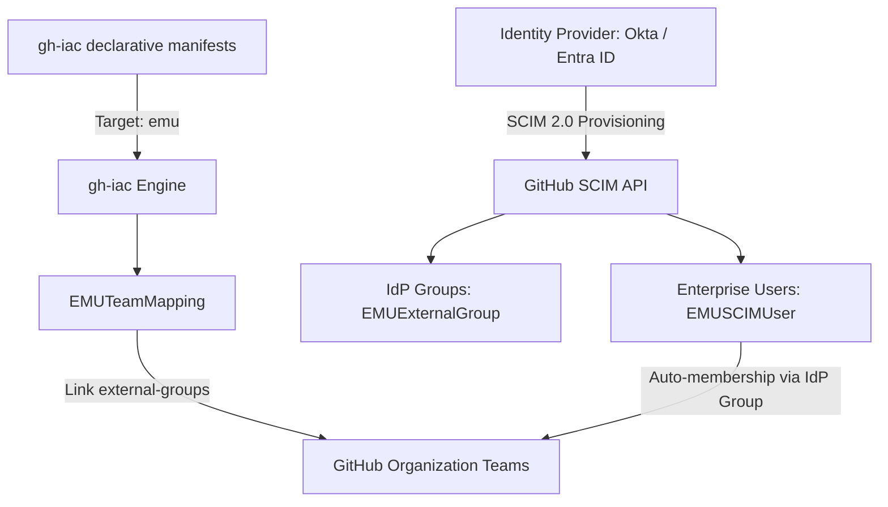

# GitHub Enterprise Managed Users (EMU): Identity Synchronization Guide & Best Practices

This guide covers architecture, identity synchronization, and automated IdP-to-Team mapping for GitHub Enterprise Cloud with Enterprise Managed Users (GHEC EMU) managed via `gh-iac`.

---

## 1. What is Enterprise Managed Users (EMU)?

GitHub Enterprise Managed Users (EMU) is an identity governance architecture where:
- Users are created, authenticated, and managed exclusively through an Identity Provider (IdP) such as Microsoft Entra ID (Azure AD), Okta, or PingFederate.
- User accounts have normalized usernames with an enterprise shortcode (e.g. `jdoe_octocorp`).
- Direct user creation or standard personal GitHub account linking is blocked.
- Provisioning and de-provisioning occur in real-time via the **SCIM 2.0 (System for Cross-domain Identity Management)** protocol.

---

## 2. Architecture & Data Flow



1. **IdP Provisions to Enterprise:**
   Okta or Entra ID provisions users and security groups into the GitHub Enterprise account via SCIM 2.0.
2. **`gh-iac` Reconciles Team Linkages:**
   `gh-iac` reads the provisioned `EMUExternalGroup` resources and executes `EMUTeamMapping` declarations to link IdP groups to GitHub Organization Teams.
3. **Automated Team Membership:**
   GitHub automatically manages team membership based on the IdP security group members without requiring manual GitHub team administration.

---

## 3. EMU Construct Declarations in `gh-iac`

### 3.1 EMU External Group (`EMUExternalGroup`)
Declares expected IdP external group synchronization records:

```yaml
apiVersion: github.iac/v1alpha1
kind: EMUExternalGroup
metadata:
  name: SecOps-Global-Engineering
  enterprise: octocorp
spec:
  externalId: okta-group-998822
  displayName: SecOps-Global-Engineering
```

### 3.2 EMU Team Mapping (`EMUTeamMapping`)
Connects an IdP external group directly to a GitHub organization team via `/orgs/{org}/teams/{team}/external-groups`:

```yaml
apiVersion: github.iac/v1alpha1
kind: EMUTeamMapping
metadata:
  name: cloud-platform-idp-link
  enterprise: octocorp
  organization: octocorp-cloud
spec:
  team_slug: cloud-platform-team
  group_id: 998822
```

---

## 4. Operational Best Practices

### 1. Always Manage Group Memberships in the IdP
With EMU, **never add users directly to teams via the GitHub UI**. GitHub will periodically overwrite or desync direct team memberships. Always assign users to the appropriate IdP security group in Okta or Entra ID.

### 2. Team Mapping Topologies
- **1:1 Mapping (Recommended):** Map one IdP security group (e.g. `Engineering-Backend`) to one corresponding GitHub team (`backend-engineers`).
- **Parent/Child Teams:** You can map distinct IdP groups to parent and child teams in GitHub to reflect your organizational hierarchy.

### 3. Deprovisioning & Offboarding
When an employee leaves the company:
- Disable or delete their account in Okta / Entra ID.
- SCIM immediately de-provisions their GitHub account, invalidating all active PATs, SSH keys, and installation tokens.
- `gh-iac` retains state integrity without requiring emergency manual credential revocation.

---

## 5. Running `gh-iac` with EMU Target

To reconcile EMU manifests against your enterprise:

```bash
# Set your enterprise admin token
export GITHUB_TOKEN="ghp_enterprise_admin_token..."

# Plan against EMU target
gh-iac plan examples/full_stack.yaml --target emu --enterprise octocorp

# Apply changes
gh-iac apply examples/full_stack.yaml --target emu --enterprise octocorp --auto-approve
```
