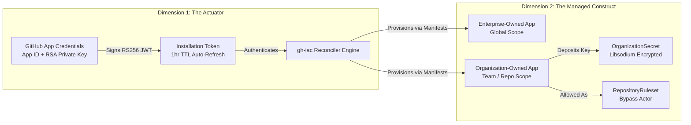

# Declarative GitHub Apps Management in `gh-iac`

This document details how **GitHub Apps** are declared, provisioned, and managed using `gh-iac` across **GitHub Enterprise Cloud (GHEC)**, **GitHub Enterprise Server (GHES)**, and **GHEC Enterprise Managed Users (EMU)**.

---

## 1. Dual Roles of GitHub Apps in `gh-iac`

GitHub Apps exist in two distinct dimensions:



1. **The Actuator (Authentication Identity):** Running `gh-iac` itself via GitHub App credentials with automatic installation token rotation.
2. **The Managed Construct:** Declaratively defining, creating, and maintaining GitHub Apps across your Enterprise or Organizations without manual web dashboard configuration.

---

## 2. Enterprise Apps vs. Organization Apps

`gh-iac` automatically determines the ownership and target endpoints based on the `metadata` block:

| Dimension | Organization-Scoped App | Enterprise-Scoped App |
| :--- | :--- | :--- |
| **Manifest Identifier** | `metadata.organization: <org-name>` | `metadata.enterprise: <enterprise-slug>` |
| **Owner** | Single organization | Enterprise Account |
| **Target API** | `/orgs/{org}/apps` | `/enterprises/{enterprise}/apps` |
| **Available Permissions** | Organization & Repository scope (`contents`, `pull_requests`, `issues`, `org_members`, `actions`) | Enterprise administrative scope (`enterprise_administration`, `enterprise_audit_log`, `enterprise_user_data`) |
| **Installation Scope** | Repositories within that organization | Enterprise-wide (`target_type: Enterprise`) or across all constituent orgs |
| **Primary Use Cases** | Team release bots, CI/CD integrators, PR review automations | Compliance monitoring, audit log collectors, org provisioning daemons, EMU group synchronization |

---

## 3. Manifest Specification: `kind: GitHubApp`

Manifests follow standard Kubernetes-style custom resource definitions:

```yaml
apiVersion: github.iac/v1alpha1
kind: GitHubApp
metadata:
  name: <app-slug-or-name>
  organization: <org-slug>       # Set for Org-Scoped App
  enterprise: <enterprise-slug>  # Set for Enterprise-Scoped App
spec:
  url: string                    # Homepage or documentation URL
  description: string            # Human-readable purpose
  public: boolean                # false (internal to org/enterprise) or true

  # Webhook delivery configuration (optional)
  hook_attributes:
    url: string                  # Webhook payload endpoint
    secret: string               # Webhook secret (supports env:SECRET or literal)
    active: boolean              # Whether webhooks are delivered

  # Fine-grained permissions matrix
  default_permissions:
    <permission_name>: read | write | admin

  # Event subscriptions
  default_events:
    - push
    - pull_request
    - release

  # Safe Credential Output Handling
  output_credentials:
    private_key_file: string     # Local file path where generated PEM is saved
    save_as_org_secret: string   # (Optional) Seed directly into an OrganizationSecret
```

---

## 4. Permissions Matrix Reference

### Enterprise-Level Permissions (for `metadata.enterprise`)

| Permission Name | Levels | Description |
| :--- | :--- | :--- |
| `enterprise_administration` | `read`, `write` | Manage enterprise settings, policies, and organizations. |
| `enterprise_audit_log` | `read` | Stream and query enterprise audit log events. |
| `enterprise_user_data` | `read` | Access identity mapping and EMU directory data. |
| `organization_administration` | `read`, `write` | Create and configure enterprise organizations. |

### Organization & Repository Permissions (for `metadata.organization`)

| Permission Name | Levels | Description |
| :--- | :--- | :--- |
| `contents` | `read`, `write` | Commit code, manage branches, and create tags. |
| `pull_requests` | `read`, `write` | Open, review, comment, and merge PRs. |
| `issues` | `read`, `write` | Manage issues, labels, and milestones. |
| `actions` | `read`, `write` | Trigger workflows and manage GitHub Actions. |
| `checks` | `read`, `write` | Post commit status and CI check runs. |
| `members` | `read`, `write` | View or manage organization members and team rosters. |
| `secrets` | `read`, `write` | Manage Actions secrets and environment variables. |

---

## 5. Private Key & Credential Lifecycle

When GitHub creates an app, it generates an RSA Private Key (`.pem`) and an OAuth `client_secret`. GitHub **never displays these credentials again**.

`gh-iac` enforces zero-leak credential handling:

### 1. Local Secure Drop
When `output_credentials.private_key_file` is set, `gh-iac` writes the private key to the specified file and applies strict filesystem permissions (`chmod 0600`), readable only by the executing process owner.

### 2. State & Log Masking
`gh-iac` automatically redacts sensitive credential fields in plan diffs and state storage:
- `client_secret` is replaced with `******`
- `pem` is replaced with `******`
- Only the `app_id`, `node_id`, `client_id`, and `slug` are stored in state.

### 3. Pipeline Chaining
You can pipe the generated private key directly into an `OrganizationSecret` manifest to make it immediately accessible to CI/CD runners using **Libsodium sealed-box public-key encryption** (`pynacl`), ensuring the raw key never touches disks or plain text.

---

## 6. Complete Manifest Examples

### Example A: Enterprise Compliance Daemon

```yaml
apiVersion: github.iac/v1alpha1
kind: GitHubApp
metadata:
  name: enterprise-compliance-daemon
  enterprise: octocorp
spec:
  url: https://compliance.octocorp.internal
  description: Global enterprise compliance auditor inspecting audit streams and policies
  public: false
  default_permissions:
    enterprise_administration: read
    enterprise_audit_log: read
    enterprise_user_data: read
  default_events:
    - audit_log_entry
    - organization
  output_credentials:
    private_key_file: ./secrets/enterprise-compliance.pem
```

### Example B: Organization Release Orchestrator with Webhook

```yaml
apiVersion: github.iac/v1alpha1
kind: GitHubApp
metadata:
  name: release-orchestrator-bot
  organization: octocorp-cloud
spec:
  url: https://release.octocorp.internal
  description: Automated release tagger and package publisher
  public: false
  hook_attributes:
    url: https://release.octocorp.internal/webhook
    secret: env:RELEASE_BOT_WEBHOOK_SECRET
    active: true
  default_permissions:
    contents: write
    pull_requests: write
    actions: read
    checks: write
  default_events:
    - push
    - pull_request
    - release
  output_credentials:
    private_key_file: ./secrets/release-orchestrator.pem
```

---

## 7. Using the Created App in Ruleset Bypass Actors

Once created, you can reference the GitHub App as an authorized bypass actor in branch protection rulesets:

```yaml
apiVersion: github.iac/v1alpha1
kind: RepositoryRuleset
metadata:
  name: protect-production
  organization: octocorp-cloud
  repository: core-infrastructure
spec:
  name: protect-production
  target: branch
  enforcement: active
  conditions:
    ref_name:
      include:
        - refs/heads/main
  rules:
    - type: pull_request
      parameters:
        required_approving_review_count: 2
  bypass_actors:
    - actor_id: 123456            # App ID of release-orchestrator-bot
      actor_type: Integration      # Specifies GitHub App
      bypass_mode: always
```

---

## 8. Authenticating `gh-iac` Using a GitHub App

To run `gh-iac` using your provisioned GitHub App in CI/CD pipelines instead of a personal access token:

```bash
# Provide App credentials
export GITHUB_APP_ID="123456"
export GITHUB_APP_PRIVATE_KEY="$(cat ./secrets/release-orchestrator.pem)"
export GITHUB_APP_INSTALLATION_ID="789012"

# Execute plan or apply
gh-iac plan examples/ --target ghec
gh-iac apply examples/ --target ghec --auto-approve
```

The underlying `GitHubAppAuthenticator` automatically signs RS256 JWTs and rotates ephemeral installation access tokens on the fly without interruption.
